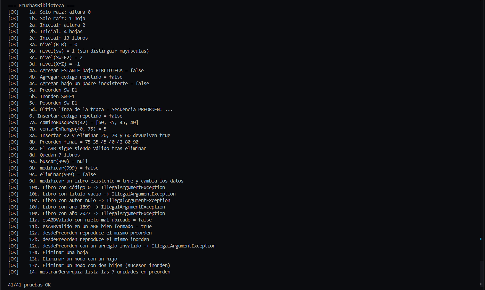

# Deber-Arboles-EspinozaKerly

**APE 3 · Estructura de Datos (Tercero, Ingeniería de Software)** — Catálogo de la Biblioteca FISEI con árbol general y ABB en Java.
Autor: Espinoza Kerly 

## 1. Problema

La Biblioteca FISEI se organiza en **Áreas** y cada Área en **Estantes** (jerarquía `BIBLIOTECA → AREA → ESTANTE`), representada con un **árbol general n-ario**.
Cada Estante guarda sus libros en un **Árbol Binario de Búsqueda (ABB)** ordenado por el código del libro (entero positivo, sin repetidos).
La aplicación construye, consulta, recorre y modifica ambas estructuras usando programación orientada a objetos y **recursividad** (sin `TreeSet`, `TreeMap`, `PriorityQueue`, `NavigableSet`, `NavigableMap` ni ordenar listas).

Estructura inicial:

```
BIB Biblioteca FISEI
├── SW Software
│   ├── SW-E1 Estante 1 de Software → 60, 35, 80, 20, 45, 70, 90, 40, 75
│   └── SW-E2 Estante 2 de Software → 15, 10, 25
├── TI Tecnologías de la Información
│   └── TI-E1 Estante 1 de TI → 50
└── TEL Telecomunicaciones
```

7 unidades, 4 hojas, altura 2 (aristas) y 13 libros.

## 2. Estructura del proyecto

```
src/
├── enums/    TipoUnidad.java, TipoRecorrido.java
├── modelo/   Libro.java, UnidadBiblioteca.java
├── negocio/  NodoUnidad.java, NodoLibro.java, ArbolBiblioteca.java, CatalogoABB.java
└── app/      Main.java, DatosPrueba.java, PruebasBiblioteca.java
```

## 3. Instrucciones de ejecución

Requisito: JDK 11 o superior (probado con JDK 21). Desde la raíz del repositorio:

```bash
# Windows (PowerShell): crear la carpeta y compilar
mkdir out
javac -encoding UTF-8 -d out src/enums/*.java src/modelo/*.java src/negocio/*.java src/app/*.java

# Menú interactivo
java -Dfile.encoding=UTF-8 -cp out app.Main

# Pruebas automáticas (muestra X/N pruebas OK)
java -Dfile.encoding=UTF-8 -cp out app.PruebasBiblioteca
```

En Visual Studio Code: abrir la carpeta del proyecto, marcar `src` como carpeta de fuentes de Java y ejecutar `Main` o `PruebasBiblioteca` con el botón *Run*.

## 4. Captura de `PruebasBiblioteca`



Resultado esperado: `41/41 pruebas OK`.

## 5. TRAZAS.md

El archivo [`TRAZAS.md`](TRAZAS.md) contiene los códigos 68, 87 y 71, los diagramas del ABB, los recorridos, la traza y los casos de eliminación. Comprueba los pasos y las salidas antes de entregar.
