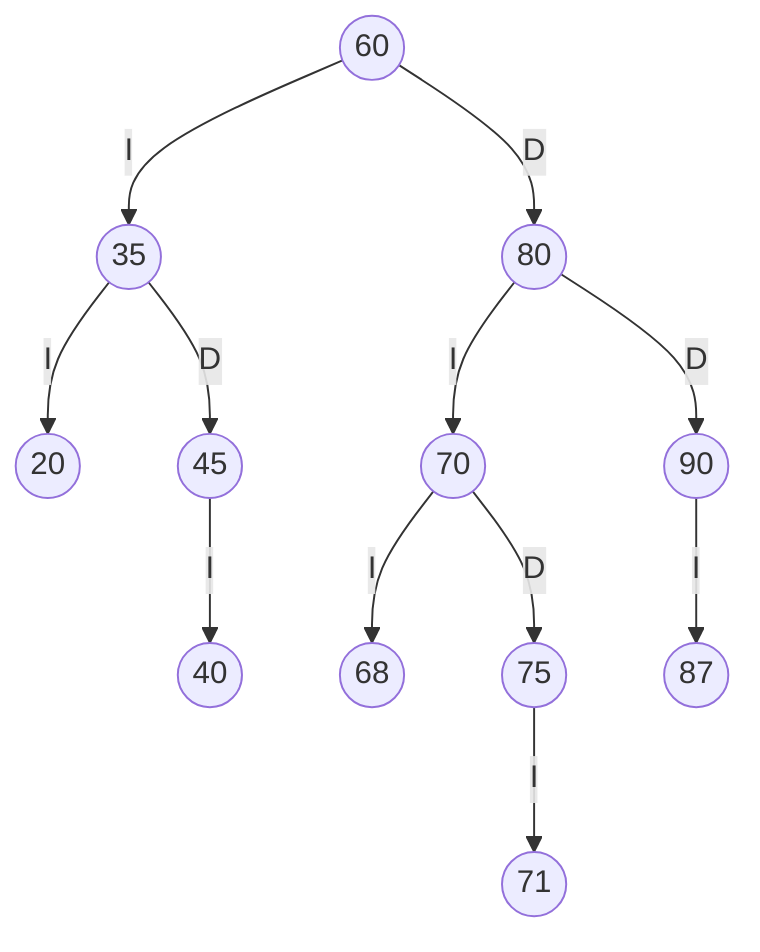
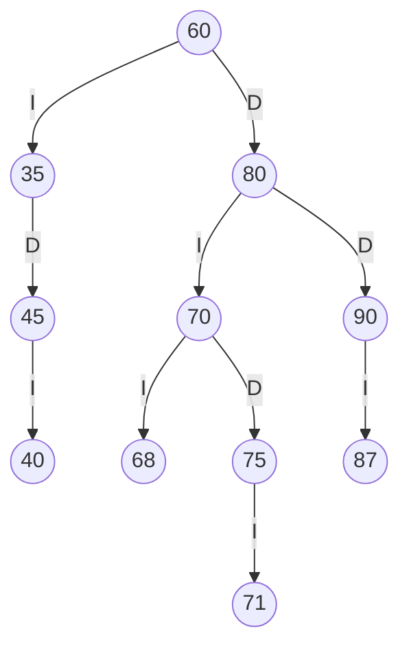
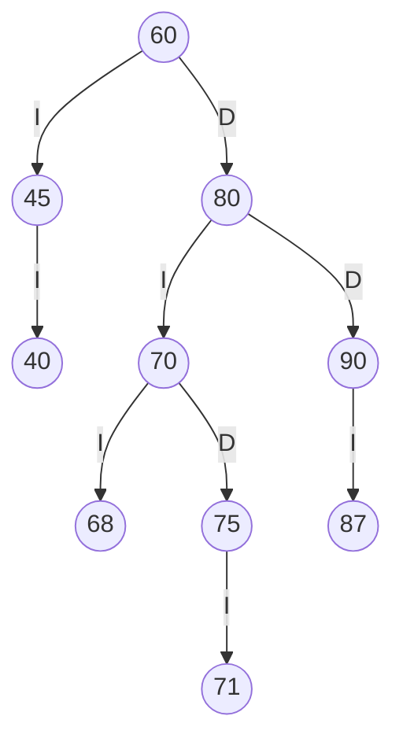
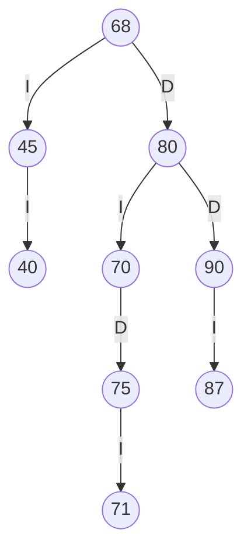

# TRAZAS.md 

Últimos cuatro dígitos: **6871** (a=6, b=8, c=7, d=1).

## 1. Tres códigos 

Con `abcd` se forman `ab`, `bc` y `cd`. Si un código es 0, se repite o ya existe en el estante, se le suma 1 (y se vuelve a comprobar).

- `ab` = 68 → válido, queda **68**
- `bc` = 87 → válido, queda **87**
- `cd` = 71 → válido, queda **71**

Códigos personales finales: **68, 87, 71**

## 2. Inserción (SW-E1)
Cada código se compara con los nodos del camino: menor → izquierda (I), mayor → derecha (D).

| Insertar | Camino de comparaciones (nodos visitados) |
|---|---|
| 60 | (árbol vacío: queda como raíz) |
| 35 | 60 |
| 80 | 60 |
| 20 | 60 → 35 |
| 45 | 60 → 35 |
| 70 | 60 → 80 |
| 90 | 60 → 80 |
| 40 | 60 → 35 → 45 |
| 75 | 60 → 80 → 70 |
| 68 | 60 → 80 → 70 |
| 87 | 60 → 80 → 90 |
| 71 | 60 → 80 → 70 → 75 |

## 3. ABB final



## 4. Recorridos del ABB final

- Preorden: `60 35 20 45 40 80 70 68 75 71 90 87`
- Inorden: `20 35 40 45 60 68 70 71 75 80 87 90`
- Posorden: `20 40 45 35 68 71 75 70 87 90 80 60`

Traza del preorden:

```text
entra 60
VISITA 60
  entra 35
  VISITA 35
    entra 20
    VISITA 20
      null -> regresa
      null -> regresa
    entra 45
    VISITA 45
      entra 40
      VISITA 40
        null -> regresa
        null -> regresa
      null -> regresa
  entra 80
  VISITA 80
    entra 70
    VISITA 70
      entra 68
      VISITA 68
        null -> regresa
        null -> regresa
      entra 75
      VISITA 75
        entra 71
        VISITA 71
          null -> regresa
          null -> regresa
        null -> regresa
    entra 90
    VISITA 90
      entra 87
      VISITA 87
        null -> regresa
        null -> regresa
      null -> regresa
Secuencia PREORDEN: 60 35 20 45 40 80 70 68 75 71 90 87
```

## 5. Eliminaciones (sobre el árbol resultante de la anterior)

### 5.1 Hoja
Se elimina **20**. Preorden resultante: `60 35 45 40 80 70 68 75 71 90 87`



### 5.2 Nodo con un hijo
Se elimina **35**. Preorden resultante: `60 45 40 80 70 68 75 71 90 87`



### 5.3 Nodo con dos hijos (sucesor inorden)
Se elimina **60**. Preorden resultante: `68 45 40 80 70 75 71 90 87`



## 6. Salida del programa y comparación

| Punto | Recorrido calculado | Salida del programa | ¿Coincide? |
|---|---|---|---|
| Preorden | `60 35 20 45 40 80 70 68 75 71 90 87` | `60 35 20 45 40 80 70 68 75 71 90 87` | coincide |
| Inorden | `20 35 40 45 60 68 70 71 75 80 87 90` | `20 35 40 45 60 68 70 71 75 80 87 90` | coincide |
| Posorden | `20 40 45 35 68 71 75 70 87 90 80 60` | `20 40 45 35 68 71 75 70 87 90 80 60` | coincide |
| Traza del preorden | 38 líneas | 38 líneas | coincide |
| Eliminar 20 (hoja) | `60 35 45 40 80 70 68 75 71 90 87` | `60 35 45 40 80 70 68 75 71 90 87` | coincide |
| Eliminar 35 (uno) | `60 45 40 80 70 68 75 71 90 87` | `60 45 40 80 70 68 75 71 90 87` | coincide |
| Eliminar 60 (dos) | `68 45 40 80 70 75 71 90 87` | `68 45 40 80 70 75 71 90 87` | coincide |
